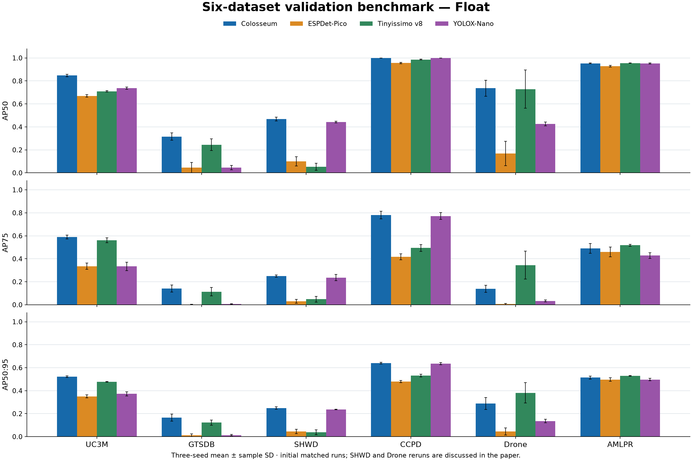
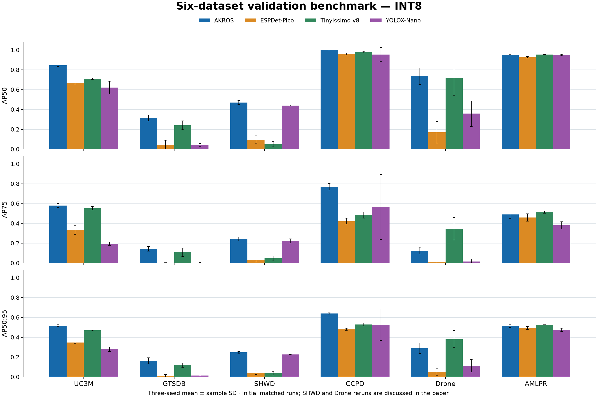
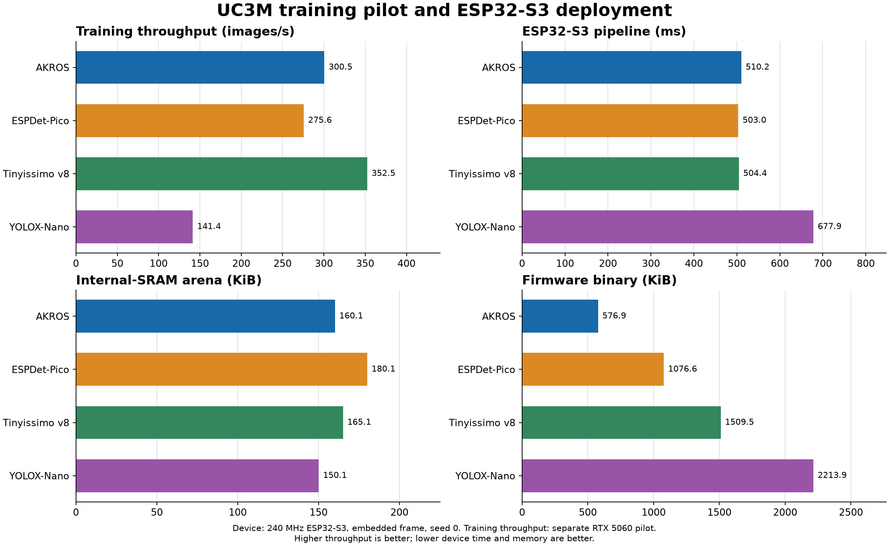
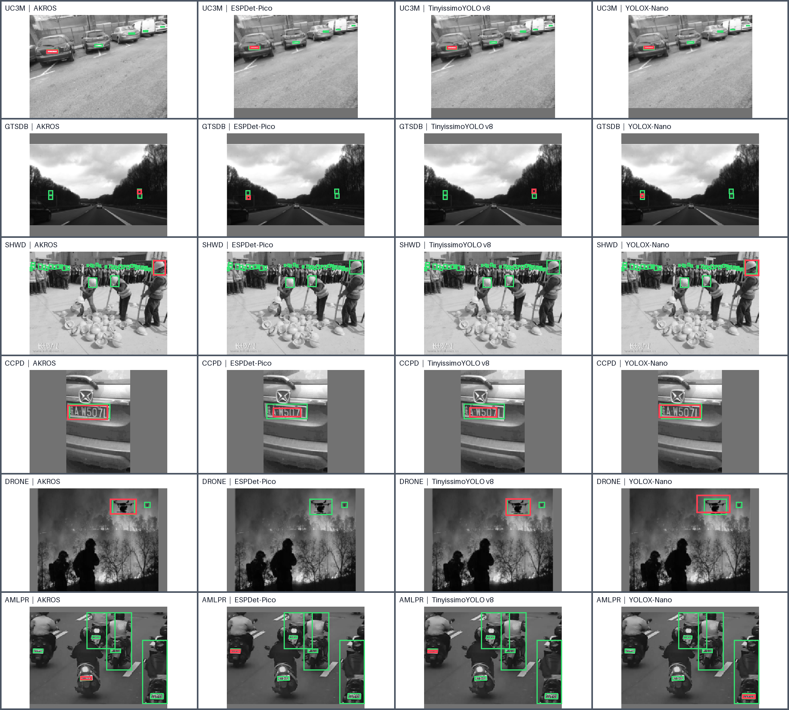

<p align="center">
  
</p>

<p align="center">
  Compact object detection for microcontrollers, with reproducible training and benchmarks.
</p>

<p align="center">
  <a href="#quick-start"></a>
  <a href="#model-zoo"></a>
  <a href="#benchmarks"></a>
  <a href="LICENSE"></a>
</p>

<p align="center">
  <a href="#quick-start">🚀 Quick start</a> &nbsp;·&nbsp;
  <a href="#model-zoo">🧠 Models</a> &nbsp;·&nbsp;
  <a href="#benchmarks">📊 Benchmarks</a> &nbsp;·&nbsp;
  <a href="#train-on-your-data">🛠️ Train on your data</a>
</p>

**Colosseum** is a compact, single-class object detector designed for microcontroller deployment. It uses fixed image-gradient features, residual convolution blocks, three-scale fusion, and separate confidence and box heads. The network has **81,403 parameters**. A checkpoint detects one target class; use a different checkpoint for a different class.

This repository provides **18 ready-to-use PyTorch checkpoints** (six datasets × three seeds), an image inference API and CLI, and the training code. Input is grayscale, letterboxed to **256 × 192** pixels. Colosseum outputs bounding boxes, not text recognition.

## Quick start

Tested with Python 3.11.

```bash
git clone https://github.com/Aqshalikhsan/Colosseum-Microcontroller.git
cd Colosseum-Microcontroller
python -m venv .venv
# Windows: .venv\Scripts\activate
# Linux/macOS: source .venv/bin/activate
pip install -r requirements.txt
python predict.py --weights weights/uc3m.pt --source path/to/image.jpg
```

Annotated images and machine-readable `predictions.json` are written to `runs/predict/`. Use `--source path/to/folder` for a folder of images, `--conf 0.25` to adjust the confidence cutoff, and `--device cuda:0` for a CUDA GPU.

Python API:

```python
from colosseum import Colosseum

model = Colosseum("weights/uc3m.pt")
for box in model.predict("path/to/image.jpg", conf=0.35):
    print(box.label, box.confidence, box.x1, box.y1, box.x2, box.y2)
```

The coordinates are pixels in the original image after EXIF orientation is applied. The prediction threshold only filters results; it does not change the model. Local confidence peaks are used to select candidate boxes.

## Model zoo

All included weights are **final checkpoints** from the reported three-seed training runs. The top-level weights are seed 0; seed 1 and 2 are in `weights/seeds/`. The complete training state was stripped; each file contains model tensors and the metadata required for inference. The `weights/manifest.json` file records SHA-256 hashes.

| Weights | Training dataset | Detects | Output stride |
|---|---|---|---|
| [`uc3m.pt`](weights/uc3m.pt) | UC3M-LP | license plate | 2 × 8 |
| [`gtsdb.pt`](weights/gtsdb.pt) | GTSDB | prohibitory traffic sign | 4 × 4 |
| [`shwd.pt`](weights/shwd.pt) | SHWD | safety helmet | 4 × 4 |
| [`ccpd.pt`](weights/ccpd.pt) | CCPD2019 | license plate | 2 × 8 |
| [`drone.pt`](weights/drone.pt) | Drone | drone | 4 × 4 |
| [`amlpr.pt`](weights/amlpr.pt) | AMLPR | license plate | 2 × 8 |

For example, use `weights/seeds/uc3m_seed1.pt` or `weights/seeds/uc3m_seed2.pt` to select another UC3M seed. The same naming convention applies to every dataset.

The dataset name identifies the training domain; three plate checkpoints are separate models trained on different images. Choose the checkpoint closest to the images you expect. These are floating-point PyTorch weights. They are not directly loadable by ESP32-S3 firmware; device deployment requires the separately quantized INT8 program and C runtime.

## Benchmarks

The plots below reproduce the **initial matched comparisons** in the paper: validation mean and sample SD across three seeds. The separate SHWD and Drone reruns changed two narrow initial rankings; see the paper before interpreting those datasets. The [accuracy data](assets/benchmark_results.csv), [device data](assets/benchmark_device.csv), and [plot script](scripts/plot_benchmark.py) are included.





The device comparison below is for **UC3M seed 0** on a 240 MHz ESP32-S3 with an embedded frame. Training throughput is a separate RTX 5060 pilot, not a device speed measurement.



The following paper figure shows selected **validation examples**, not aggregate performance. Green boxes are targets; red boxes are the top prediction when present.



## Train on your data

Colosseum uses YOLO-format single-class annotations. For a new dataset, put images and labels in `images/train`, `images/val`, `labels/train`, and `labels/val`, then make a `data.yaml`. One command trains both stages and packages weights:

```bash
python train.py --data my_dataset/data.yaml --name my_object --label "my object" --grid 4x4
python predict.py --weights runs/custom/my_object/seed0/colosseum.pt --source path/to/image.jpg
```

The script computes box-size priors from training labels only. Use `--grid 2x8` for elongated horizontal targets, `--seeds 0 1 2` for three runs, and `--source-class N` when the target's YOLO class ID is not zero. See the [full custom-training guide](docs/TRAINING.md) for the dataset layout, options, and manual commands. Raw datasets and official test images are not included here.

## Reproducibility

- Input: grayscale, bilinear resize preserving aspect ratio, gray padding value 114.
- Architecture: fixed-gradient stem, regular bottleneck blocks, multiscale fusion, one confidence channel and four geometry channels.
- Geometry: normalized boxes with a prior-log width and height encoding; priors are saved in each checkpoint.
- Files under `src/` retain some internal legacy names because they are also used by the training and checkpoint export pipeline. The public model name is Colosseum.

Please cite the Colosseum paper when it becomes available. The datasets remain subject to their source terms; no raw dataset images are redistributed here.

## License

Code and the 18 Colosseum weight files are released under the [MIT License](LICENSE). Third-party datasets are excluded.
